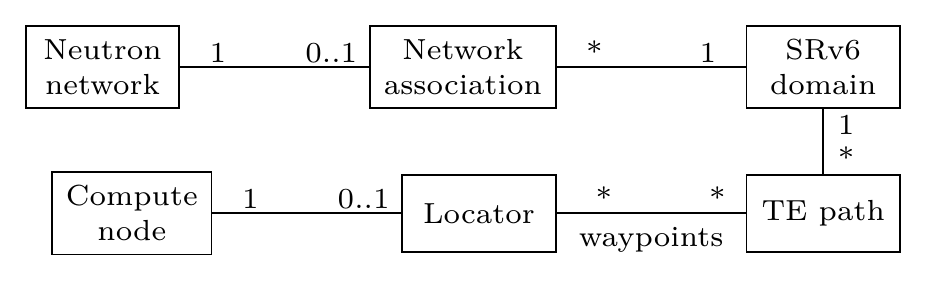
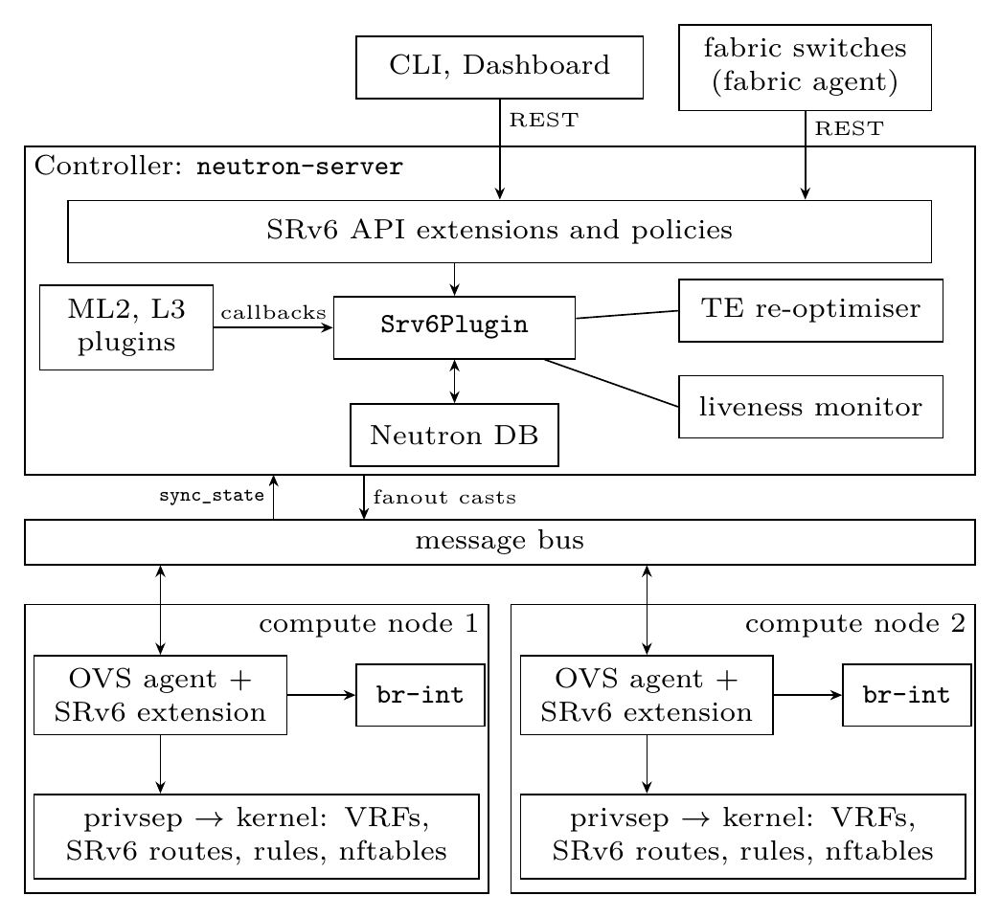
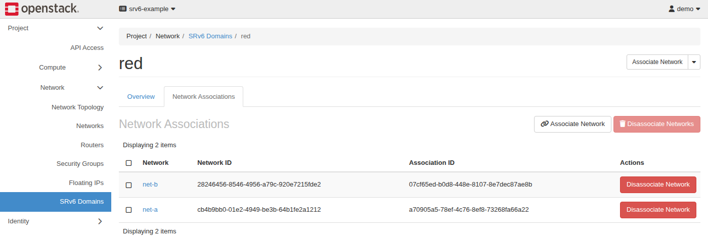
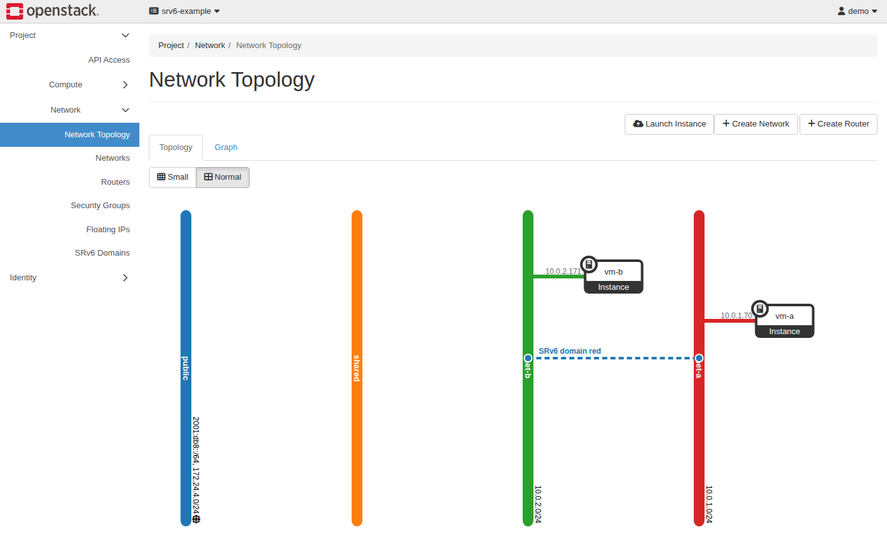
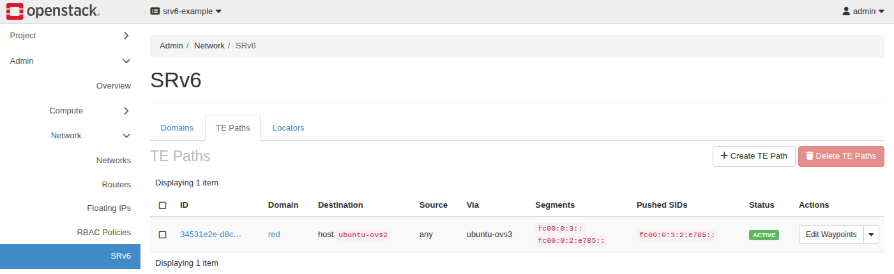
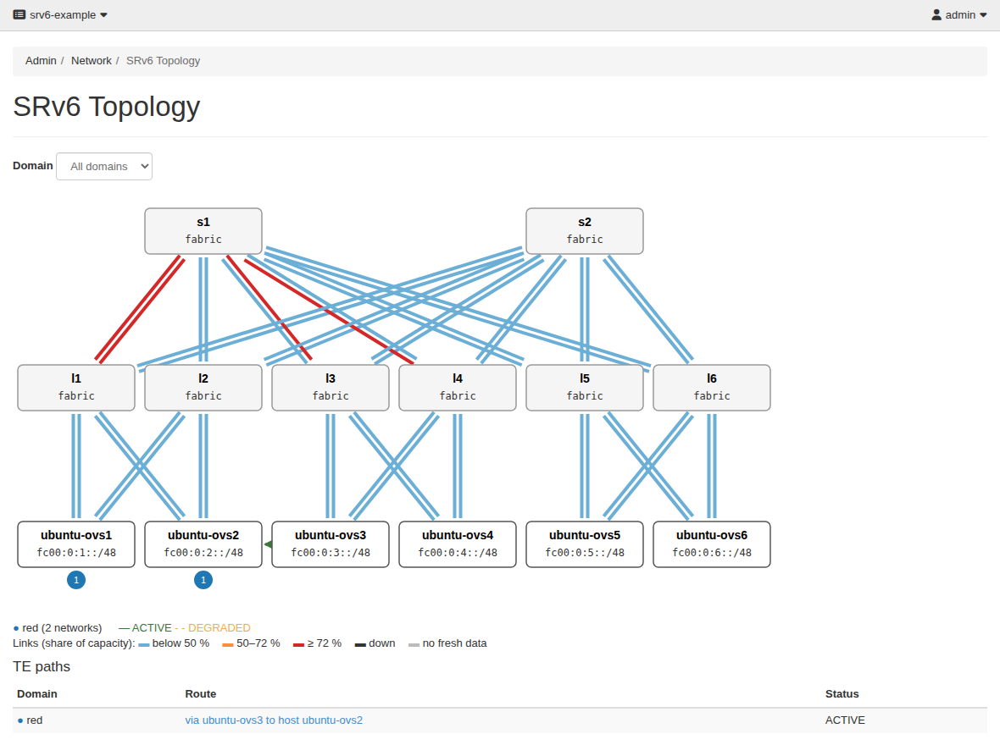

=====================
networking-srv6-agent
=====================

SRv6 connectivity and traffic engineering for OpenStack Neutron (ML2/OVS).

.. contents::
   :local:
   :depth: 1

What it does
------------

The plugin adds a new Neutron routing mode for the traffic between a
project's networks, based on Segment Routing over IPv6 (SRv6). It bridges
the Linux kernel, which already implements SRv6, with the Open vSwitch agent
of every node. It is a standalone package: Neutron is not modified.

Concepts
~~~~~~~~

         network association, which belongs to one SRv6 domain; a domain
         has TE paths, whose waypoints are locators, one per compute node.
   :width: 460

=======================  =====================================================
Resource                 Meaning
=======================  =====================================================
SRv6 domain              A set of networks of one project, routed to each
                         other over SRv6. Gets a function id
                         (``0xe000``-``0xefff``) from which its SIDs and its
                         routing table on every node derive. Domains are
                         isolated from each other, even with overlapping
                         addresses.
Network association      Joins a network to a domain, like a router interface
                         joins a network to a router. The network must
                         belong to the domain's project, not be external,
                         have no router interface, be in no other domain,
                         and have no subnet overlapping the domain's.
Locator                  A node's /48 prefix (e.g. ``fc00:0:2::/48``), set in
                         the agent config. A domain's SID on a node is the
                         locator plus the domain's function id.
TE path (admin)          Waypoints (compute nodes or fabric switches) that
                         part of a domain's traffic must cross. Written by
                         the admin, or created by the server to relieve a
                         congested link.
=======================  =====================================================

Architecture
------------

         the SRv6 API extensions, Srv6Plugin, the TE re-optimiser and the
         liveness monitor; a message bus; on each compute node, the OVS
         agent with the SRv6 extension programming the kernel via privsep.
   :width: 520

======================  ===============  =====================================
Component               Runs in          Role
======================  ===============  =====================================
API extensions          neutron-server   REST resources and policies.
                                         ``extensions/``, ``api/``,
                                         ``policies/``
``Srv6Plugin``          neutron-server   Validates requests, allocates
                                         function ids, builds each domain's
                                         payload, notifies the agents.
                                         ``services/plugin.py``
TE resolver             neutron-server   Turns TE paths into SID lists per
                                         route. ``services/te_resolver.py``
Liveness monitor        neutron-server   Marks TE paths ``DEGRADED`` when a
                                         waypoint dies, active when it is back.
                                         ``services/te_liveness.py``
TE re-optimiser         neutron-server   Optional: moves heavy VM pairs off
                                         congested links.
                                         ``services/underlay/``
Agent extension         OVS agent,       Applies the payloads to the kernel.
                        every node       ``agent/``
Privileged helpers      privsep daemon   ``ip``, ``modprobe``, ``nft`` as
                                         root. ``privileged/``
Fabric agent            fabric switches  Optional: posts link load and heavy
                                         VM pairs.
                                         ``tools/srv6-fabric-agent.py``
======================  ===============  =====================================

How a change reaches the nodes:

1. An API call (or a VM starting, stopping or moving) changes the state in
   the Neutron database.
2. ``Srv6Plugin`` builds the domain's **payload**: function id, networks
   with their subnets and MTU, every node's locator, and one route per VM
   address naming the node that hosts it, with the SID list of any TE path.
3. The server sends a fanout cast to every agent: ``domain_updated`` (the
   whole payload) or ``routes_updated`` (only the changed routes).
4. Each agent makes its kernel match the payload. Domains are built only on
   nodes that host one of their VMs.
5. Every agent also calls ``sync_state`` at start-up and every
   ``resync_interval`` (300 s) to repair lost or reordered messages.

Example
-------

Two networks of one project, joined by domain ``red``, with a VM on each,
on two different compute nodes: ``node1`` (locator ``fc00:0:1::/48``) and
``node2`` (locator ``fc00:0:2::/48``). A third node, ``node3``
(``fc00:0:3::/48``), is used later as a waypoint.

1. Create the networks and the domain
~~~~~~~~~~~~~~~~~~~~~~~~~~~~~~~~~~~~~

::

    openstack network create net-a
    openstack subnet create --network net-a --subnet-range 10.0.1.0/24 sub-a
    openstack network create net-b
    openstack subnet create --network net-b --subnet-range 10.0.2.0/24 sub-b

    openstack srv6 domain create red
    openstack srv6 network association create red net-a
    openstack srv6 network association create red net-b
    openstack srv6 domain show red          # function id, e.g. 0xe005

    # one VM per network, pinned to two nodes (needs admin)
    openstack server create --image cirros --flavor m1.tiny \
        --network net-a --availability-zone nova:node1 vm-a   # 10.0.1.10
    openstack server create --image cirros --flavor m1.tiny \
        --network net-b --availability-zone nova:node2 vm-b   # 10.0.2.20

``--availability-zone nova:<host>`` chooses the compute node (``openstack
compute service list`` shows the names); without it the scheduler picks one.
The VMs need no configuration: they keep using their subnet's gateway.

2. What appears on the nodes
~~~~~~~~~~~~~~~~~~~~~~~~~~~~

Only nodes that host a VM of ``red`` get its state. On ``node1``, the agent
installs the equivalent of (the table number is the function id,
``0xe005`` = 57349)::

    # the domain's VRF; the unreachable default ends lookups that find
    # nothing, so traffic never leaks into the host's tables
    ip link add sv6vrf-57349 type vrf table 57349
    ip -4 route add unreachable default metric 4278198272 table 57349
    ip -6 route add unreachable default metric 4278198272 table 57349

    # red's SID on node1 (locator + function id): strip the outer header
    # and look the inner packet up in the VRF
    ip -6 route add fc00:0:1:e005::/64 encap seg6local \
        action End.DT46 vrftable 57349 dev sv6vrf-57349

    # net-a's gateway, an OVS port inside the VRF (every node hosting
    # net-a has its own 10.0.1.1)
    ovs-vsctl add-port br-int svp-57349-1 tag=1 \
        -- set interface svp-57349-1 type=internal
    ip link set svp-57349-1 master sv6vrf-57349
    ip addr add 10.0.1.1/24 dev svp-57349-1

    # vm-b: encapsulate toward red's SID on node2, and send the
    # encapsulated packet to the underlay (rule 999)
    ip route add 10.0.2.20/32 encap seg6 mode encap.red \
        segs fc00:0:2:e005:: dev eth0 table 57349
    ip -6 rule add pref 999 iif sv6vrf-57349 \
        to fc00:0:2:e005::/128 lookup main

``node2`` gets the mirror image: SID ``fc00:0:2:e005::``, net-b's gateway
``10.0.2.1``, and a route to ``vm-a`` toward ``fc00:0:1:e005::``. To see it:
``ip -br link show type vrf``, ``ip -6 route show table all | grep seg6``,
``ip route show table 57349``.

3. A packet from vm-a to vm-b
~~~~~~~~~~~~~~~~~~~~~~~~~~~~~

``vm-a`` sends to its gateway ``10.0.1.1``. The VRF on ``node1`` matches the
route to ``10.0.2.20`` and wraps the packet in an IPv6 header addressed to
``fc00:0:2:e005::`` (40 bytes, no SRH). The underlay delivers it to
``node2``, where ``End.DT46`` strips the header and puts the packet into
``red``'s VRF, whose connected route for ``net-b`` hands it to ``vm-b``. No
router namespace, network node or L3 agent is involved.

4. Steer it through a waypoint
~~~~~~~~~~~~~~~~~~~~~~~~~~~~~~

::

    openstack srv6 te path create --domain red --destination-host node2 \
        --via-host node3
    openstack srv6 te path list --domain red --long     # status ACTIVE

On ``node1`` only the route to ``vm-b`` (and its rule) change: the
destination becomes ``fc00:0:3:2:e005::``, which lists ``node3``, then
``node2``, then the function. ``node3`` shifts its own entry out and
forwards the packet to ``fc00:0:2:e005::``. Up to four waypoints fit in the
same 40-byte header; a longer path adds an SRH. If ``node3`` goes down, the
path turns ``DEGRADED`` and the traffic falls back to the direct route.

5. Clean up
~~~~~~~~~~~

::

    openstack srv6 te path delete <id>
    openstack server delete vm-a vm-b
    openstack srv6 domain delete red

Deleting the domain (or an association) removes its state from every node.

CLI and dashboard
-----------------

``openstack command list --group openstack.srv6.v2`` lists every CLI
command. Domains and associations::

    openstack srv6 domain list --long
    openstack srv6 domain show red
    openstack srv6 network association list red
    openstack srv6 network association delete red net-a

A domain routes traffic *between* its networks only: traffic between two
VMs of the same network stays on L2 (VXLAN) and never uses SRv6.

TE paths (admin)
~~~~~~~~~~~~~~~~

::

    # all of red's traffic toward node2 goes through node3
    openstack srv6 te path create --domain red --destination-host node2 \
        --via-host node3

    # only the traffic entering the domain at node1
    openstack srv6 te path create --domain red --destination-host node2 \
        --source-host node1 --via-host node3

    # only toward one VM port, or only from one VM port
    openstack srv6 te path create --domain red --destination-port vm-b-port \
        --via-host node3 --via-host node4
    openstack srv6 te path create --domain red --destination-host node2 \
        --source-port vm-a-port --via-host node4

    openstack srv6 te path list --domain red --long
    openstack srv6 te path set <id> --via-host node4   # re-steer
    openstack srv6 te path set <id> --no-via-host      # explicitly direct
    openstack srv6 te path delete <id>

``--via-host`` can be repeated; waypoints are hosts, or fabric nodes named in
the topology file. When several paths match, the most specific wins:
source + port > source + host > port > host > direct. A path whose source
and destination ports are on the same network is refused (that traffic
never enters the domain).

Link state and automatic steering (admin, optional)
~~~~~~~~~~~~~~~~~~~~~~~~~~~~~~~~~~~~~~~~~~~~~~~~~~~

Everything above works without this part. It adds a feedback loop on the
underlay: telemetry agents on the fabric switches report link load and the
heaviest VM pairs; every ``te_reopt_interval`` the server looks for links
loaded above ``te_reopt_high`` and gives the largest pairs on them a path of
their own (``origin=auto``). The path is chosen by the built-in **path
computation** (CSPF: fewest hops over links with room, then the widest
bottleneck) and released when the pair goes idle or the link has room
again. Manual TE paths never use it: their waypoints are the ones you give.

It needs a topology file on the controller (without it, link state is
disabled and fabric nodes cannot be waypoints) and the telemetry agent on
every fabric switch (without it there is nothing to measure, so the server
never steers anything). How to set both up: *Build the fabric* in
`DEPLOYMENT.rst <DEPLOYMENT.rst>`__. Watch it::

    openstack srv6 link list --long        # load per link, stale flag
    openstack srv6 aggregate list --long   # heavy VM pairs per link
    openstack srv6 te path list --long     # origin=auto: steered by server

Thresholds and limits are the ``te_reopt_*`` and ``te_auto_*`` options in
``[srv6]`` (``oslo-config-generator`` lists them all with help text).

Horizon
~~~~~~~

The ``srv6_dashboard`` package adds these panels under *Network*:

==========================  =======  ==========================================
Panel                       Who      What it does
==========================  =======  ==========================================
Project → SRv6 Domains      project  Create, edit and delete domains; attach
                                     and detach networks. CLI: ``srv6
                                     domain``, ``srv6 network association``.
Project → Network Topology  project  Horizon's topology view, with each domain
                                     drawn as a link between its networks.
Admin → SRv6                admin    Three tabs: all domains, TE paths
                                     (create, edit waypoints, delete) and
                                     node locators. CLI: ``srv6 te path``,
                                     ``srv6 locator``.
Admin → SRv6 Topology       admin    The underlay graph with the live load of
                                     every link (needs the topology file).
                                     CLI: ``srv6 link list``.
==========================  =======  ==========================================

The screenshots below show the example above on a six-node test bed, where
``node1``, ``node2`` and ``node3`` are ``ubuntu-ovs1``, ``ubuntu-ovs2`` and
``ubuntu-ovs3``, with traffic flowing from ``vm-a`` to ``vm-b`` along the TE
path.

         Associations tab, listing net-a and net-b.
   :width: 700

         joined by a dashed line labelled SRv6 domain red.
   :width: 700

         ubuntu-ovs2 via ubuntu-ovs3, with its segments and pushed SID
         fc00:0:3:2:e785::, status ACTIVE.
   :width: 700

         nodes; the links of the steered path from ubuntu-ovs1 through
         ubuntu-ovs3 to ubuntu-ovs2 are drawn red (over 72 percent load).
   :width: 700

Repository layout
-----------------

``networking_srv6_agent/`` -- the Neutron plugin (Python package)
  - ``services/``: the service plugin. ``plugin.py`` is the entry point
    (API calls, SID allocation, validation); ``rpc.py`` talks to the agents;
    ``te_resolver.py`` decides which path each TE path really takes;
    ``te_liveness.py`` re-pushes paths when a waypoint dies or comes back;
    ``pce.py`` is the path computation (CSPF); ``workload.py`` finds the VM
    ports and their hosts.
  - ``services/underlay/``: the optional automatic steering. It stores the
    link load and heavy VM pairs sent by the telemetry agents and moves
    pairs off congested links.
  - ``agent/``: the agent extension. ``agent_extension.py`` reacts to port and
    domain events; ``dataplane.py`` turns them into kernel state.
  - ``privileged/``: the few operations that need root (``ip`` route and
    link commands, ``modprobe vrf``, ``nft`` rulesets), run through privsep.
  - ``api/definitions/`` and ``extensions/``: the REST resources (domains,
    associations, locators, TE paths, link state, aggregates).
  - ``db/``: database models and queries; ``db/migration/`` holds the
    Alembic migrations.
  - ``policies/``: who may call each API (oslo.policy rules).
  - ``cli/``: the ``openstack srv6 ...`` commands (OpenStackClient plugin).
  - ``common/``: configuration options and SID arithmetic.
  - ``tests/unit/``: unit tests (``stestr``).

``srv6_dashboard/`` -- the Horizon panels
  ``dashboards/project/`` (SRv6 domains, network topology with domains),
  ``dashboards/admin/`` (SRv6 overview, underlay topology), ``api/`` (calls to
  the Neutron API), ``enabled/`` (the files that register the panels in
  Horizon), ``test/`` (dashboard tests).

``devstack/`` -- the DevStack plugin
  ``plugin.sh`` installs and configures everything on a node; ``settings``
  holds the ``SRV6_*`` variables and their defaults.

``tools/``
  ``srv6-fabric-agent.py``, the optional telemetry agent for underlay switches
  (link load and heavy VM pairs); ``srv6-fabric-lab.py``, which builds a test
  spine-leaf fabric of libvirt VMs from a topology file (see the deployment
  guide).

Deploying
---------

The plugin needs ML2/OVS with VXLAN, a Linux kernel with SRv6 and VRF
support (6.1 or newer for ``usid``), and an IPv6 underlay that routes every
node's locator. The `deployment guide <DEPLOYMENT.rst>`__ explains each
requirement, lists the DevStack settings and walks through a complete
test cloud: three DevStack nodes on a spine-leaf fabric of SRv6 switches.

Configuration reference
-----------------------

Only ``locator`` has no default and must be set; every other option works
as is. The tables list the main options, ``oslo-config-generator`` lists
all of them with their help text.

``[srv6]`` in ``neutron.conf`` (controller)
~~~~~~~~~~~~~~~~~~~~~~~~~~~~~~~~~~~~~~~~~~~

======================== ================= ===================================
Option                   Default           What it does
======================== ================= ===================================
``dataplane_encoding``   ``usid``          ``usid`` or ``encap``, one value for
                                           the whole deployment. Change it only
                                           with no domains: restart the server,
                                           then the agents.
``function_id_ranges``   ``0xe000:0xefff`` SID function ids, shared by all
                                           projects (4096). Do not change.
``vrf_table_base``       ``0``             A domain's VRF table is this plus its
                                           function id.
``te_liveness_interval`` ``15`` s          How often to look for dead TE
                                           waypoints. Failover time is about
                                           Neutron's ``agent_down_time`` plus
                                           this; ``0`` = off.
``topology_file``        unset             Underlay topology; enables link state
                                           (see the *Link state* section).
``te_auto_steering``     ``true``          Let the server steer heavy VM pairs
                                           off congested links.
``te_reopt_interval``    ``10`` s          How often link load is checked;
                                           ``0`` = off.
======================== ================= ===================================

The other ``te_reopt_*``, ``te_auto_*`` and ``link_state_*`` options are
thresholds and limits, described under *Link state and automatic steering*.

``[srv6_agent]`` in the OVS agent config (every node)
~~~~~~~~~~~~~~~~~~~~~~~~~~~~~~~~~~~~~~~~~~~~~~~~~~~~~

The file the OVS agent reads (``ml2_conf.ini`` in DevStack)::

    [srv6_agent]
    locator = fc00:0:1::/48

======================== ================= ===================================
Option                   Default           What it does
======================== ================= ===================================
``locator``              required          This node's IPv6 prefix, unique per
                                           node and routed by the underlay. The
                                           agent does not start without it.
``underlay_interface``   auto              Interface the encapsulated packets
                                           leave by. Unset, it is found from
                                           the route to the locator.
``resync_interval``      ``300`` s         Full resync with the server.
``apply_sysctls``        ``true``          The agent sets the kernel sysctls
                                           SRv6 needs. Set ``false`` if config
                                           management owns ``seg6_enabled``,
                                           ``forwarding``, ``rp_filter``...
======================== ================= ===================================

``[quotas]`` in ``neutron.conf``
~~~~~~~~~~~~~~~~~~~~~~~~~~~~~~~~

``quota_srv6_domain`` is the number of domains per project (default ``10``,
``-1`` = unlimited). All projects share the 4096 function ids.

License
-------

Apache 2.0, see ``LICENSE``.
